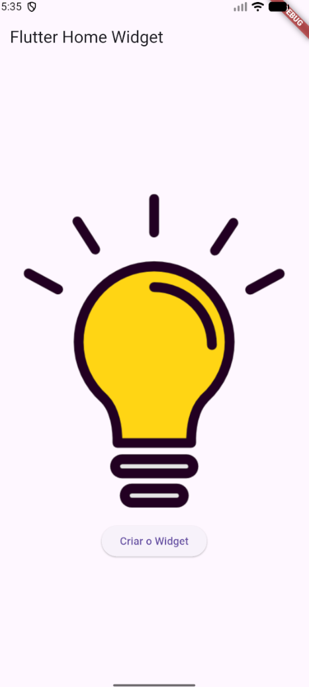
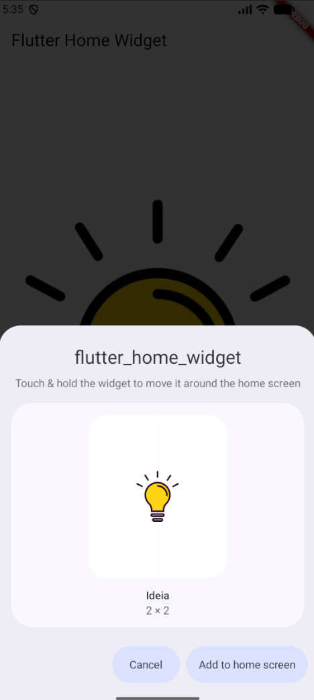
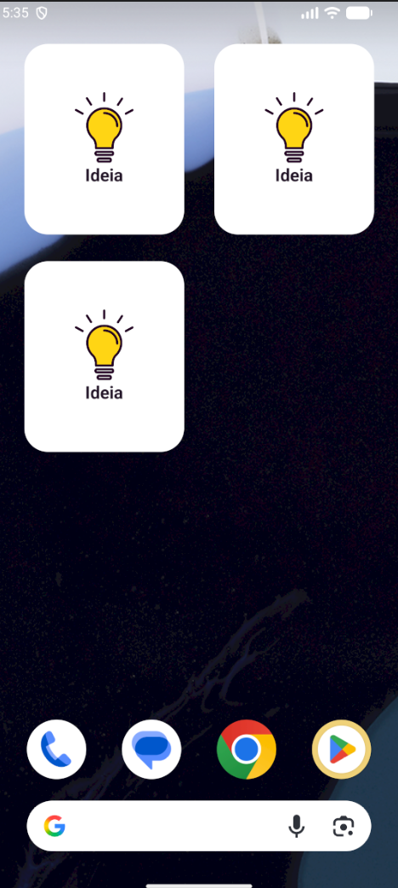

# Flutter Home Widget

Exemplo de aplicativo Flutter que adiciona um widget à tela inicial do Android. O app mostra uma lâmpada e oferece o botão **Criar o Widget**. Ao tocar nele, o Android pede confirmação para fixar o widget na tela inicial. O widget exibe a lâmpada e o texto **Ideia**; um toque nele abre o aplicativo.

O projeto usa o pacote [`home_widget`](https://pub.dev/packages/home_widget) para compartilhar o texto com o widget nativo e solicitar sua fixação. A interface do widget fica em `flutter_home_widget/android/app/src/main/res/layout/meu_home_widget.xml`.

## APK

- Para gerar o apk, basta usar o comando dentro da pasta `flutter_home_widget`:
```bash
flutter build apk --release
```

## Arquivos configurados conforme o tutorial

1. **Dependências e imagem:** o [pubspec.yaml](flutter_home_widget/pubspec.yaml) declara `home_widget`, `flutter_launcher_icons` e os assets. A imagem [assets/icone.png](flutter_home_widget/assets/icone.png) aparece no aplicativo e serve como ícone.
2. **Registro no Android:** o [AndroidManifest.xml](flutter_home_widget/android/app/src/main/AndroidManifest.xml) registra o receiver `MeuHomeWidget` e aponta para `@xml/meu_home_widget_info`.
3. **Tela e botão:** o [main.dart](flutter_home_widget/lib/main.dart) salva o texto `Ideia`, atualiza o widget pelo nome `com.example.flutter_home_widget.MeuHomeWidget` e solicita sua fixação na tela inicial.

O receiver e o XML citados no tutorial também precisam dos arquivos Android abaixo para compilar e mostrar o widget:

| Arquivo | Função |
| --- | --- |
| [MeuHomeWidget.kt](flutter_home_widget/android/app/src/main/kotlin/com/example/flutter_home_widget/MeuHomeWidget.kt) | Lê o texto salvo pelo Flutter, atualiza a interface do widget e abre o app quando ele é tocado. |
| [meu_home_widget_info.xml](flutter_home_widget/android/app/src/main/res/xml/meu_home_widget_info.xml) | Define tamanho, layout inicial e categoria do widget. |
| [meu_home_widget.xml](flutter_home_widget/android/app/src/main/res/layout/meu_home_widget.xml) | Organiza a lâmpada e o texto `Ideia`. |
| [icone_widget.png](flutter_home_widget/android/app/src/main/res/drawable/icone_widget.png) | Disponibiliza a imagem ao layout nativo do Android. |
| [meu_home_widget_background.xml](flutter_home_widget/android/app/src/main/res/drawable/meu_home_widget_background.xml) | Define o fundo branco com cantos arredondados. |
| [widget_strings.xml](flutter_home_widget/android/app/src/main/res/values/widget_strings.xml) | Define o texto padrão e a descrição da imagem. |

## Capturas de tela

| Aplicativo | Confirmação do Android | Widget na tela inicial |
| --- | --- | --- |
|  |  |  |

## Executar

Com o Flutter instalado e um dispositivo ou emulador Android conectado:

```bash
cd flutter_home_widget
flutter pub get
flutter run
```

## Exemplo em outro projeto

Veja [Flutter API Receitas](https://github.com/zenvexy/Flutter-API-Receitas) para acompanhar como ficaram as alterações com widgets nesse repositório.
